<!-- Generated by build.py from profile.json. Edit those files, not this one. -->

<picture><source media="(prefers-color-scheme: dark)" srcset="assets/banner-dark.svg"></picture>

## Model card <sub><code>rev. 2026.10</code></sub>

<table>
<tr><td><code>Model</code></td><td>Kaze, computer science student</td></tr>
<tr><td><code>Architecture</code></td><td>curiosity → prototype → iterate</td></tr>
<tr><td><code>Intended use</code></td><td>Useful software, playful interactions, creative experiments</td></tr>
<tr><td><code>Training data</code></td><td>Projects, documentation, trial and error</td></tr>
<tr><td><code>Toolchain</code></td><td>Code, AI collaboration, and whatever the idea needs</td></tr>
<tr><td><code>Known limitations</code></td><td>Still learning; always iterating</td></tr>
<tr><td><code>Fine-tuning on</code></td><td>Software, AI tools, and robotics</td></tr>
</table>

## System prompt

```text
[system] Building things I want to exist. Public project demos are on the way.
```


<p align="center"><code>&lt;|endoftext|&gt;</code><br>
<sub>compiled from <a href="profile.json">profile.json</a> by <a href="build.py">build.py</a> · banner art redrawn daily</sub></p>
